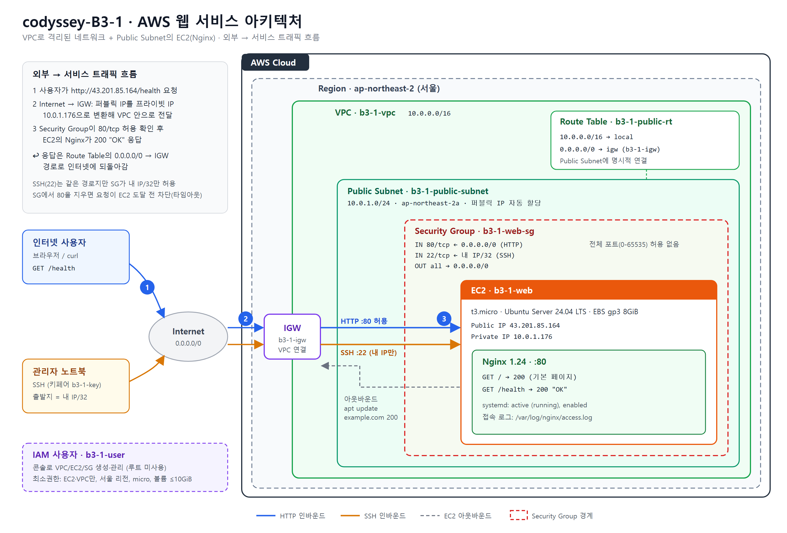
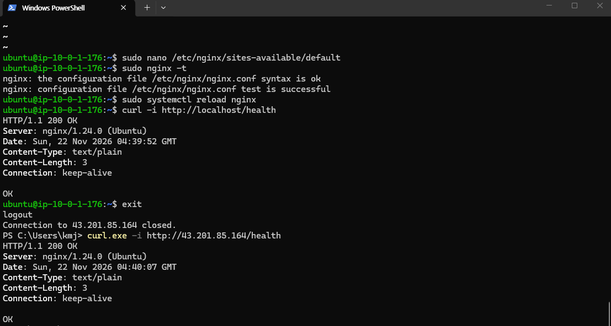

# codyssey-B3-1

내가 만든 웹사이트를 인터넷에 올려 누구나 쓰게 하기 — AWS VPC + EC2 + Nginx

## 결과물

| 항목 | 위치 |
|---|---|
| 아키텍처 다이어그램 | [docs/architecture.png](docs/architecture.png) |
| 트러블슈팅 보고서 | [docs/troubleshooting.md](docs/troubleshooting.md) |
| 리소스 정리 체크리스트 | [docs/cleanup-checklist.md](docs/cleanup-checklist.md) |
| IAM 최소권한 정책 | [docs/iam-policy.md](docs/iam-policy.md) / [JSON](docs/iam-policy.json) |
| 서버 설정 기록 | [docs/server-setup.md](docs/server-setup.md) |
| 스크린샷 | [docs/images/](docs/images/) |

## 아키텍처

- 원본: [docs/architecture.html](docs/architecture.html) (브라우저로 열어 수정 가능, PNG는 이 파일을 렌더링한 결과)

## 외부 접속 검증

- **선택한 방식: (B) `GET http://<퍼블릭IP>/health`**
- 접속 정보: **http://43.201.85.164/health**
- 기대 응답: `HTTP/1.1 200 OK`, 본문 `OK`

## 인스턴스 정보

| 항목 | 값 |
|---|---|
| 리전 | ap-northeast-2 (서울) |
| 인스턴스 | b3-1-web (t3.micro, Ubuntu Server 24.04 LTS, EBS 8GiB) |
| 퍼블릭 IP | 43.201.85.164 |
| 프라이빗 IP | 10.0.1.176 (b3-1-public-subnet) |
| SSH 사용자 | ubuntu (키: b3-1-key) |
| 웹 서버 | Nginx 1.24.0 |

## 검증 결과

| 요구사항 | 결과 | 증빙 |
|---|---|---|
| Route Table에 `0.0.0.0/0 → IGW` | ✅ | [06-route-table-igw](docs/images/06-route-table-igw.png) |
| 인스턴스 → 인터넷 아웃바운드 | ✅ `https://example.com` HTTP 200, `apt update` 성공 | |
| SG: 80은 0.0.0.0/0, 22는 내 IP/32만, 전체 포트 허용 없음 | ✅ | [07-security-group-inbound](docs/images/07-security-group-inbound.png) |
| SSH 접속 | ✅ `ubuntu@ip-10-0-1-176` | |
| Nginx 실행 상태 | ✅ `active (running)`, `enabled` | [10-nginx-status-running](docs/images/10-nginx-status-running.png) |
| 인스턴스 내부 `curl http://localhost` | ✅ HTTP 200 | |
| 인스턴스 내부 `curl http://localhost/health` | ✅ HTTP 200 / `OK` | [11-health-local-and-external](docs/images/11-health-local-and-external.png) |
| 외부 `GET http://43.201.85.164/health` | ✅ HTTP 200 / `OK` | [11-health-local-and-external](docs/images/11-health-local-and-external.png) |
| IAM 최소권한 (AdministratorAccess 미부여) | ✅ EC2/VPC만 허용, 결제 화면 액세스 거부 확인 | [02](docs/images/02-iam-policy-permissions.png), [03](docs/images/03-iam-policy-attached-user.png), [05](docs/images/05-iam-login-success-billing-denied.png) |

## 계정 운영 원칙

- 루트 계정은 MFA 설정, 예산 알림 생성, IAM 사용자 생성에만 사용
- 모든 실습은 IAM 사용자 `b3-1-user`로 진행
- 액세스 키는 발급하지 않음 (콘솔 + SSH 키페어만 사용)
- 예산 알림: 월 2 USD 초과 시 이메일
